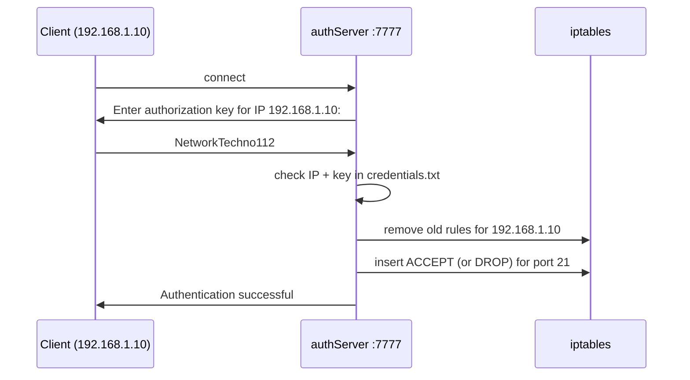

# FTP Access Control

An FTP server whose access is controlled by a firewall. Only a fixed list of IP addresses can reach FTP at first. Any other client can gain access by connecting to an authentication service on port 7777 and entering a key; the service then opens FTP for that client’s IP with an iptables rule. A wrong key explicitly blocks the IP, even if it was allowed before.



## What the setup does

- Installs `vsftpd` and creates the user `ftp_user` with two sample files.
- Blocks ping (ICMP echo requests) from all hosts.
- Allows FTP only from the IPs passed to the install script and drops it for everyone else.
- Runs `authServer` on port 7777 as a systemd service.

**How the firewall decisions work**

- The general “drop all FTP” rule is appended to the end of the chain (`-A`), while per-client decisions are inserted at the top (`-I`), so a client’s own rule always takes priority.
- Before adding a new decision, all previous rules for that IP are removed, so only the latest authentication result applies.
- The IP and key must match a line in `credentials.txt` exactly. An empty or partial key never passes.
- The credentials file is readable only by root, and every attempt is logged to `/var/log/authServer.log`.
- The install script checks for existing rules before adding them, so it can be run again safely.

## Install

```bash
./install.sh 192.168.0.105,10.10.1.2
```

The argument is a comma-separated list of IPs that get FTP access right away.

## Use

Authenticate from a client machine:

```bash
nc <server-ip> 7777
Enter authorization key for IP 192.168.1.10:
NetworkTechno112
Authentication successful. FTP access granted for 192.168.1.10.
```

Then connect to FTP as `ftp_user` and download `1.txt` or `2.txt`.

Keys are stored in `credentials.txt`, one `<IP> <key>` pair per line. The keys and the FTP password in this repository are demo values.

## Files

| File | Purpose |
| --- | --- |
| `install.sh` | Installs vsftpd, sets up the firewall, the FTP user and the auth service |
| `authServer.sh` | Checks a client’s key and updates iptables rules for its IP |
| `authServer.service` | systemd unit that runs `socat` on port 7777 |
| `credentials.txt` | IP and key pairs allowed to authenticate |
