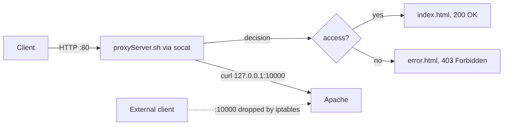

# Reverse Proxy Gate

A proxy that sits in front of an Apache web server and decides, for every request, which page the client gets. Apache is moved to port 10000 and closed to the outside world with iptables, so the only way in is through the proxy on port 80.



## How it works

- `socat` listens on port 80 and starts `proxyServer.sh` for each connection.
- The script reads the HTTP request, makes an access decision, fetches the right page from Apache over localhost and returns a proper HTTP response with a status code, headers and the page. If Apache is down, the client gets `502 Bad Gateway`.
- iptables accepts port 10000 only on the loopback interface, so Apache cannot be reached directly from another machine.
- Every request is logged to the systemd journal: `journalctl -u proxyServer -f`.

The access rule itself is a placeholder: it combines the proxy’s process ID with a hash of the current process list, so roughly half of the requests are allowed. It stands in for the place where a real system would check authentication or rate limits.

## Install

```bash
./install.sh
```

Then open `http://<VM IP>/` in a browser and refresh a few times to see both pages. Requests to `http://<VM IP>:10000/` from outside the VM will time out.

## Files

| File | Purpose |
| --- | --- |
| `install.sh` | Installs Apache, moves it to port 10000, sets up the firewall and the proxy |
| `proxyServer.sh` | Handles one HTTP request and returns the chosen page |
| `proxyServer.service` | systemd unit that runs `socat` on port 80 after Apache starts |
| `index.html`, `error.html` | Pages for allowed and denied requests |
