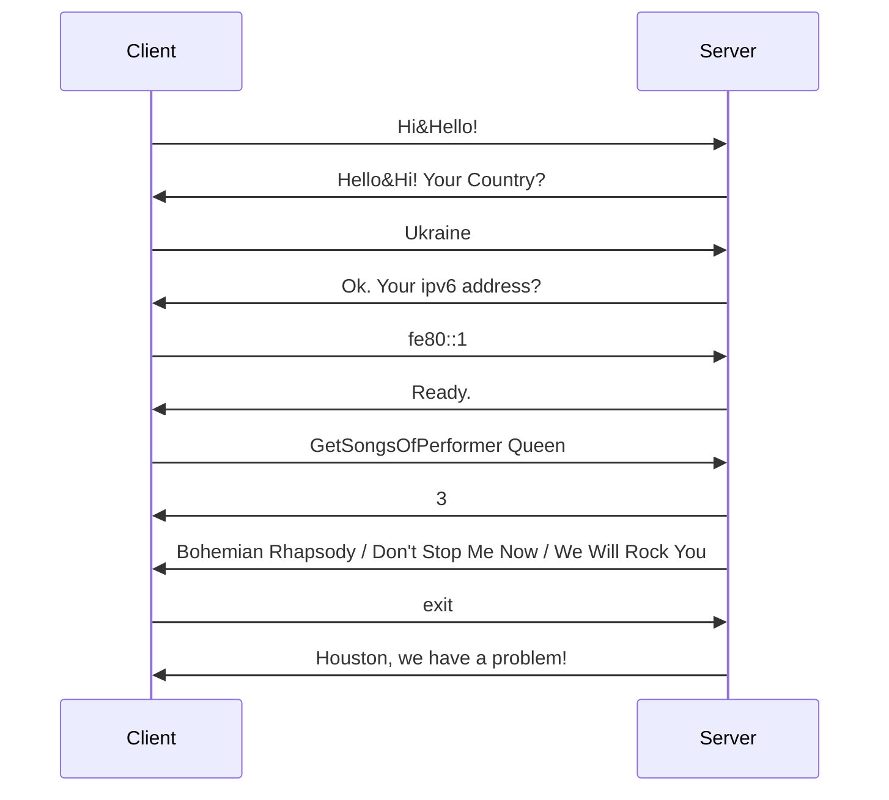

# TCP API Server

A server and an interactive client that communicate over a custom text protocol on top of TCP. The client must complete a handshake before it can query a small music database: find the album for a song, or list all songs of a performer.

## Protocol

Every message is one line of text. The connection starts with a three-step handshake, and the server drops the connection immediately if the client deviates from it or sends invalid data. The client does the same if the server answers unexpectedly.



| Command | Response |
| --- | --- |
| `GetAlbumBySong <song>` | Album that contains the song |
| `GetSongsOfPerformer <performer>` | All songs of the performer |
| `exit` | Closing message, then the connection is closed |

A response starts with the number of results `N`, followed by `N` lines. `0` means nothing was found. Errors are returned as a single line starting with `ERROR`.

**Details**

- Each handshake step has a 10-second timeout; the country and IPv6 address are validated.
- Command arguments are checked against an allow-list of characters, and lookups use exact, case-insensitive matching, so user input is never interpreted as a pattern.
- Every handshake, request and dropped connection is logged to `/var/log/apiServer.log` with the client’s address.
- The database is a semicolon-separated text file: `Song;Performer;Album`.

## Install the server

```bash
./install.sh
sudo systemctl status apiServer
```

The server listens on port 4242 and restarts automatically if it crashes.

## Use the client

The client needs only Bash, it connects through the built-in `/dev/tcp`.

```
$ ./apiClient.sh 127.0.0.1
Your country [Ukraine]:
Your IPv6 address [fe80::5054:ff:fe12:3456]:
Connected to 127.0.0.1:4242.
> GetSongsOfPerformer Queen
  Bohemian Rhapsody
  Don't Stop Me Now
  We Will Rock You
> GetAlbumBySong let it be
  Let It Be
> exit
Houston, we have a problem!
```

## Files

| File | Purpose |
| --- | --- |
| `apiServer.sh` | Handles one client connection: handshake, commands, logging |
| `apiServer.service` | systemd unit that runs `socat` on port 4242 |
| `apiClient.sh` | Interactive client |
| `db.txt` | Database with 20 records |
| `install.sh` | Installs and starts the server |
